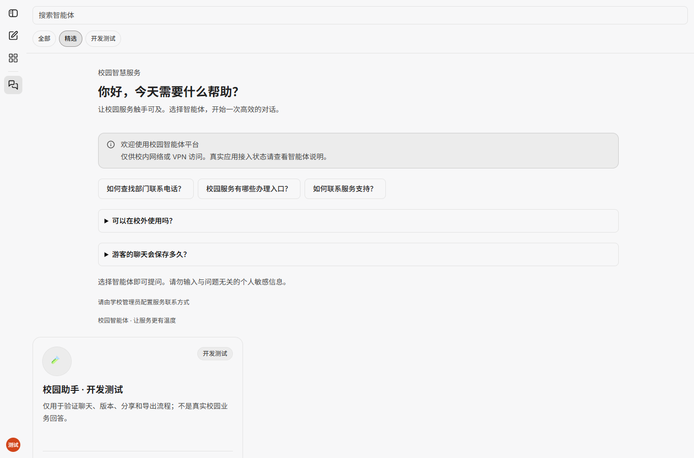
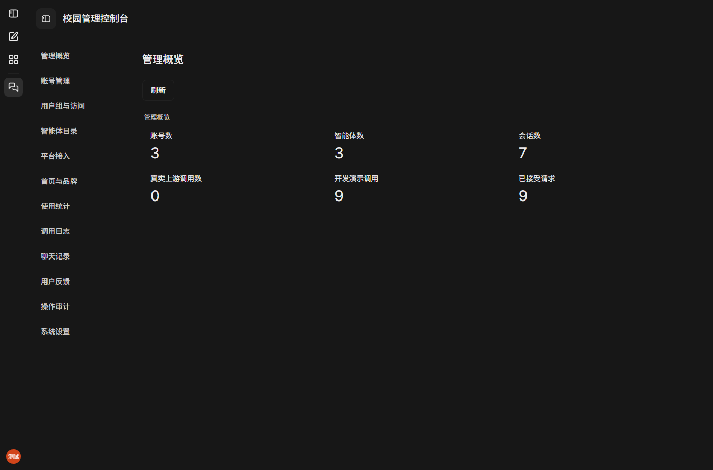
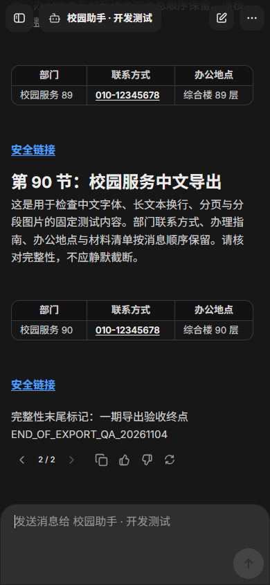
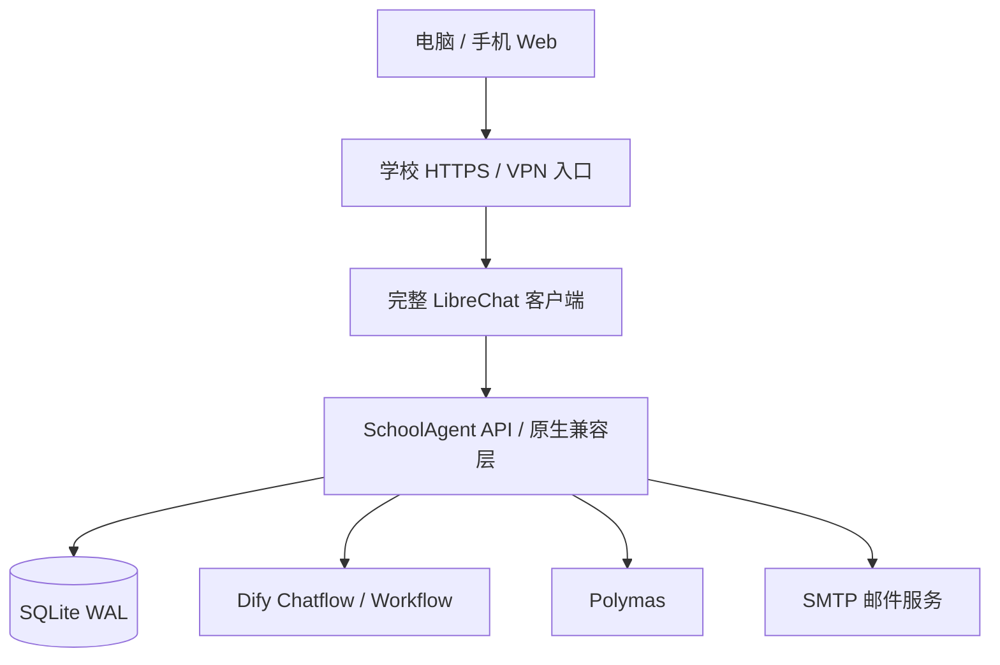

<div align="center">

# SchoolAgent

**让校园智能体拥有统一的入口、对话体验与管理能力。**

基于完整 LibreChat 客户端构建的校园智能体平台，连接学校工作流，统一账号、权限与会话管理。

A self-hosted campus AI agent portal built on the full LibreChat client.

[](https://github.com/ScyPolit/SchoolAgent/actions/workflows/ci.yml)
[](LICENSE)
[](https://nodejs.org/)
[](docs/librechat-latest.md)
[](docs/deployment.md)

[快速开始](#快速开始) · [界面预览](#界面预览) · [部署文档](docs/deployment.md) · [开发指南](CONTRIBUTING.md) · [路线图](#路线图)

</div>

---

## 项目简介

SchoolAgent 面向需要统一使用多个智能体的学校：业务知识、提示词和工作流在外部平台维护，SchoolAgent 提供校园访问入口、对话体验、权限控制与运营管理。

前端直接采用完整 **LibreChat `latest(dev)` 对应源码**，在原版导航、输入器、消息树、分享、导出和主题上增删修改；校园管理使用同一组件库。服务端采用独立的 Node.js / SQLite 实现，通过兼容层对接原版客户端，统一身份和数据。

> **开发状态**：当前为第一期开发版本。截至 2026-11-05，Polymas 官方协议已读取，已实现网关签名、智能助手和工具工作流 V2；本地后端 87 项、前端专项 15 项测试通过，生产客户端构建及主要界面流程已验证，三次浏览器冷启动通过原版中位数性能预算。Docker 配置已提供，尚未执行镜像构建或部署验收；真实校内 Dify、正式 SMTP、学校网络与微信真机仍待联调。Polymas 的真实发布应用仍待凭据与业务联调，不能把本地协议夹具视为真实平台验收。完整范围见[测试报告](docs/test-report.md)和[已知限制](docs/known-issues.md)。

## 功能一览

| 能力 | 已实现内容 |
| --- | --- |
| 智能体入口 | 目录、分类、推荐、搜索与详情，按用户组控制可见和调用范围 |
| 原版对话体验 | 多轮会话、SSE 增量、停止、重新生成、回答版本切换及分支历史 |
| 校园账号 | 游客访问、邮箱注册验证、密码找回、账号管理、登录后自主迁移游客记录 |
| 分享与导出 | 带到期时间的固定分享快照；Markdown、中文 PDF、PNG，超长图片按顺序分段为 ZIP |
| 管理后台 | 概览、账号、用户组、智能体目录、平台接入、首页品牌、统计、调用日志、聊天记录、反馈、审计、系统设置 |
| 数据与权限 | SQLite WAL 持久化、服务端对象归属校验、独立管理授权、保留策略、在线备份与恢复工具 |
| 平台适配 | Dify Chatflow / Workflow、Polymas 智能助手 / 工具工作流 V2；服务端加密凭据与真实调用测试 |
| 学校部署 | Docker 多阶段构建、非 root 运行、SSE 代理、HTTPS / 校内网 / VPN 入口模板 |

原版 light / dark / system 主题保持可用。一期聚焦文本对话；文件上传、语音、知识库编辑、工作流编辑和主智能体自动编排不在当前范围。

## 界面预览

以下图片来自本地运行的真实客户端和开发测试数据，展示当前界面；开发回答明确标记为演示，不代表真实校园业务或生产部署。

### 智能体市场 · 原版浅色主题



<details>
<summary><strong>查看校园管理后台 · 原版深色主题</strong></summary>



</details>

<details>
<summary><strong>查看移动端对话 · 中文表格与电话链接</strong></summary>

<p align="center"></p>

</details>

## 技术架构



| 层次 | 实现 |
| --- | --- |
| 客户端 | React 18 · TypeScript · Vite · LibreChat 原版组件与主题 |
| 校园服务端 | Node.js 24 · Express 5 · SQLite |
| 工作流 | 服务端适配器 · SSE 解析 · 独立调用状态与活动分支历史 |
| 导出 | Chromium / Playwright · 中文字体 · 分段 PNG / ZIP |
| 部署 | Docker Compose · nginx · 独立密钥与持久化卷 |

上游基线固定为 [`f4154b6`](https://github.com/LibreChat-AI/LibreChat/tree/f4154b649efa37e1345ccc517a4d8d1ed2178c82) / `v0.8.9-rc1`。完整源码随仓库分发，普通 `git clone` 即可获取，无需额外初始化子模块。基线、许可和本地修改清单见[源码说明](docs/librechat-latest.md)。

## 快速开始

### Docker 本地演示

需要 **Git、Node.js 24+、Docker Engine / Desktop 和 Docker Compose v2+**。下面使用开发覆盖文件启动演示适配器及 Mailpit 测试邮箱；这些命令是运行手册，本项目尚未完成 Docker 环境实测。

```bash
git clone https://github.com/ScyPolit/SchoolAgent.git
cd SchoolAgent

# 生成 .env 和独立加密密钥，不创建默认密码
node scripts/bootstrap.js

# 启动本地开发环境与测试邮箱
docker compose -f compose.yml -f compose.dev.yml --profile mail up -d --build

# 交互创建管理员，密码不回显
docker compose exec app node scripts/init-admin.js
```

| 入口 | 地址 |
| --- | --- |
| 平台 | [http://localhost:8080](http://localhost:8080) |
| Mailpit 测试邮箱 | [http://localhost:8025](http://localhost:8025) |

首次空库会初始化开发 SMTP。登录后从账户菜单进入「校园管理控制台」，配置学校内容、用户组及智能体。演示适配器只验证本平台流程。

### 学校正式部署

先配置实际 HTTPS 域名、校内 / VPN 来源范围、SMTP 和已发布工作流，再使用生产 Compose：

```bash
docker compose up -d --build
docker compose exec app node scripts/init-admin.js
```

生产模式强制安全 Cookie 并禁止开发适配器。默认只绑定宿主机回环地址，通过学校 HTTPS 代理访问；**不要把本地 HTTP 演示配置直接用于正式环境**。完整配置、网络模板、密钥管理、备份与恢复见[部署手册](docs/deployment.md)。

### 本地源码开发

```bash
npm ci
npm run install:client
node scripts/bootstrap.js
```

将生成的 `.env` 中以下项目设置为本地开发值，再启动服务：

```dotenv
NODE_ENV=development
COOKIE_SECURE=false
ENABLE_DEMO_ADAPTER=true
PUBLIC_URL=http://127.0.0.1:5173
```

```bash
npm run dev
```

前端地址为 `http://127.0.0.1:5173`，校园服务端端口为 `3000`。管理员可在另一个终端执行 `npm run init-admin` 创建。本机 PDF / PNG 导出需要 Chromium，可执行 `npx playwright install chromium`；也可通过 `PLAYWRIGHT_CHROMIUM_EXECUTABLE_PATH` 指定系统 Chrome / Chromium。

## 工作流接入

### Dify

在管理后台填写实例 API 基地址、应用模式和 API Key，并配置问题、历史及答案输出映射。密钥仅保存在服务端。Chatflow 使用当前活动分支的完整历史恢复新上游会话；Workflow 的多轮能力需要应用提供历史输入变量。

适配器已有本地 HTTP / SSE 契约测试，**尚未完成校内真实实例联调**。配置与取消能力边界见[适配说明](docs/chat-adapters.md)，官方协议依据见[公开 API 调研](docs/public-api-research.md)。

### Polymas

已根据官方登录后文档实现网关令牌签名/缓存、AES 参数加密、智能助手 SSE 与工具工作流 V2。后台可选择应用类型、响应方式、问题/历史变量与主答案字段，密钥分项加密保存。首页内容改为逐项编辑，模块和保留期限提供选择控件。详细步骤见 [Polymas 接入指南](docs/polymas-integration.md)。

真实网关鉴权、加密编码与学校应用业务效果仍待联调；默认只展示已映射的最终答案。文档未提供远程停止接口，停止仅结束本地接收并如实提示。

## 测试与构建

```bash
npm test              # 校园后端、原生兼容层与协议测试
npm run build         # 编译上游共享包和完整客户端，输出到 dist/
```

2026-11-05 的本地验证快照：

| 检查 | 结果 |
| --- | --- |
| 后端与兼容层 | **87 / 87 通过** |
| 完整客户端生产构建 | 通过；客户端类型检查及 15 项校园前端回归通过 |
| 原版界面主要流程 | 既有原版流程证据保留；本轮验证新配置表单保存/回显、首页逐项编辑和手机布局 |
| 中文长会话导出 | 11-04 既有证据：PDF 25 页；PNG 两段，总高 23,777px；Markdown 完整性与版本选择已核对 |
| 三次浏览器冷启动 | LCP **1265ms** · CLS **0.0204** · TBT **244ms**，均为三次中位数 |
| 20 路并发 | 本地协议夹具通过；真实工作流容量尚未验收 |

这些数字是已记录的本地快照。最新持续集成状态以顶部 CI 徽章为准；真实平台、正式邮件、学校网络、微信真机和 Docker 验收范围分别记录在[测试报告](docs/test-report.md)。

## 项目结构

```text
SchoolAgent/
├── server/                  # 账号、权限、管理、聊天、导出及工作流适配
├── upstream/LibreChat/      # 完整上游源码与校园修改
├── third_party/             # 上游基线、完整许可与修改清单
├── scripts/                 # 构建、初始化、备份、恢复及测试工具
├── tests/                   # 校园后端与兼容协议测试
├── deploy/                  # nginx 与学校 HTTPS / VPN 入口模板
├── docs/                    # 架构、部署、接入、验证与界面截图
├── archive/                 # 早期实现归档，不参与运行
├── compose.yml              # 生产环境配置
└── compose.dev.yml          # 本地演示覆盖配置
```

## 文档导航

| 我想了解 | 文档 |
| --- | --- |
| 安装、学校网络与运维 | [部署手册](docs/deployment.md) |
| 身份、数据和模块设计 | [架构说明](docs/architecture.md) |
| Dify 配置与多轮策略 | [工作流适配](docs/chat-adapters.md) |
| 原版源码与二次开发边界 | [LibreChat 基线](docs/librechat-latest.md) |
| 已验证内容及性能数据 | [测试报告](docs/test-report.md) |
| 尚未完成与运行边界 | [已知限制](docs/known-issues.md) |
| 一期需求与验收映射 | [需求追踪](docs/requirement-traceability.md) · [验收清单](docs/acceptance.md) |

## 路线图

- [x] 完整 LibreChat 客户端与校园 API 兼容层
- [x] 校园账号、用户组、管理后台及持久化
- [x] 会话版本、游客迁移、分享与三种导出
- [x] Dify Chatflow / Workflow 协议实现与本地回归
- [ ] 校内 Dify 已发布应用端到端联调
- [x] Polymas 正式文档协议适配与选择式后台
- [ ] Polymas 学校发布应用真实联调
- [ ] Docker 部署、学校 HTTPS / VPN、正式邮件与微信真机验收
- [ ] 真实上游 20 路并发与业务回答验证
- [ ] 后续：学校统一身份映射与主智能体路由

## 参与贡献

欢迎提交 Bug、文档改进和 Pull Request。开始前请阅读[贡献指南](CONTRIBUTING.md)；安全问题请按[安全政策](SECURITY.md)私下报告。新的平台适配应提供协议依据、脱敏样例和针对性测试。

## 开源许可与致谢

SchoolAgent 原创代码采用 [MIT License](LICENSE)，维护者为 [ScyPolit](https://github.com/ScyPolit)。

感谢 [LibreChat](https://github.com/LibreChat-AI/LibreChat) 提供完整客户端与组件体系，以及 [Dify](https://github.com/langgenius/dify) 提供工作流平台与开放 API。SchoolAgent 是独立的校园适配项目；上游源码、字体和其他第三方资产保留各自许可与版权声明，详见[第三方说明](THIRD_PARTY_NOTICES.md)。
