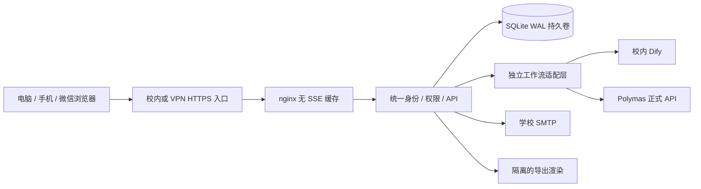

# 架构与开源复用决策

本项目使用完整 LibreChat 最新开发镜像对应的客户端源码（React 18 / Vite 8），校园服务端使用 Node.js 24 / Express 5 / SQLite WAL。前后端同源部署，保留一套学校账号、会话和权限模型。生产容器只运行一个校园服务端进程；nginx 负责反向代理，学校入口代理负责 HTTPS 及校内/VPN 来源限制。SQLite 数据持久化在独立卷，不依赖容器可写层。

## 选型比较

| 路径 | 可复用部分 | 本期成本与取舍 |
| --- | --- | --- |
| 整套 LibreChat 二次开发 | 原账号、数据库、提供方、会话和聊天界面 | 官方账号入口要求登录；游客、迁移、细粒度正文授权、固定校园首页及非模型工作流需要贯穿原有后端。需要同时维护原提供方/数据库语义与学校业务差异 |
| 完整 LibreChat 客户端 + 学校统一后端（采用） | 原版 React 应用、路由、聊天壳、导航、组件库、输入、消息、主题和设置 | 直接修改上游源码增加校园业务；通过兼容 API 对接统一学校账号、会话和工作流。保留全部原前端源码，不运行原版 Mongo/账号后端 |
| Open WebUI 整套二次开发 | Pipe 扩展和成熟界面 | 同样需要验证游客和独立正文权限；学校品牌定制需处理其附加许可条件，不作为本次实现基线 |
| LobeHub | 对话交互与设计参考 | 提供方并不等于原生工作流接入；许可与部署边界额外复杂，不作为本次实现基线 |

根据用户最新要求，固定基线已更新为官方 `librechat-dev:latest` 镜像对应的 main 源码 `v0.8.9-rc1` / `f4154b649efa37e1345ccc517a4d8d1ed2178c82`，不在构建时跟随浮动分支。实际源码位于 `upstream/LibreChat`；完整客户端直接参与构建，校园功能只能在这一上游应用基础上增删修改。原始版本与 MIT 许可见 [最新版基线](../third_party/librechat-latest/baseline.json)、[源码与构建说明](librechat-latest.md)。此前的 `v0.8.1` 模块抽取和自制页面已经归档，退出运行入口。

上游原版 API 通过 `/api/librechat` 兼容路由进入同一学校服务端，原校园 API 保留独立命名空间。原版界面继续使用原认证上下文与数据提供层，由兼容服务映射到学校已有会话 Cookie、用户组和聊天记录，避免在浏览器或数据库中产生第二套可独立授权的身份系统。

## 请求与数据边界

浏览器只访问本平台。外部 API 凭据以 AES-256-GCM 加密保存在数据库，独立密钥通过 Docker secret 注入，不发送到客户端。管理员接口按功能鉴权，正文查看、正文导出、清理分别授权。数据库、浏览器匿名标识、回答版本与真实调用记录分别建模。

适配层接收当前活动历史，不依赖 React 页面。Dify Chatflow 使用新上游会话加活动历史重放，避免回答分支切换污染已有上游会话；Workflow 必须显式配置历史输入才能支持多轮。Polymas 按正式文档区分助手和工具 V2：网关凭据与 appCode 分离，令牌缓存在服务端，工具只呈现映射后的最终输出。助手重放活动历史，工具必须配置历史输入；没有文档依据的远程停止降级为 local_only。

流式链路只转发真实上游回答增量。非增量结果展示处理中并一次完成；停止保留部分正文并忽略迟到事件。原生远端取消不可用或无法核实终态时显示真实限制。分享是固定快照，独立于后续消息并可撤销到期。

## 运维边界

生产默认禁止开发模拟适配器。本地测试通过不代表真实 Dify/Polymas、正式 SMTP、学校 VPN、微信和 20 路真实上游并发已验收。对应外部条件与验收状态见 [integration-checklist.md](integration-checklist.md) 和 [acceptance.md](acceptance.md)。

应用容器不以 root 运行，文件系统只读，仅数据卷、备份卷和临时目录可写。反向代理只公开主机回环端口；应用所在内部网络不开放业务端口，单独出口网络允许访问工作流和 SMTP。学校必须配置真实 LAN/VPN 网段、证书及可达站内域名，分享和邮件链接同样使用该域名。
