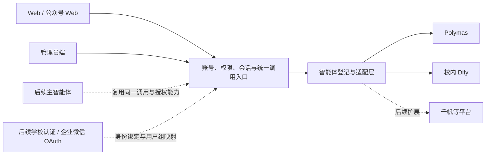

# 校园智能体平台需求分析

版本：v1.0  
日期：2026-11-04（Asia/Shanghai）  
状态：已根据需求访谈整理业务基线；技术接入与部署条件尚需验证。本文交付需求分析，不代表系统已经开发、联调或通过验收。

配套文档：[平台接入与上线待办](integration-checklist.md)、[开源对话平台评估](ui-evaluation.md)。

## 1. 建设目标

建设面向单所学校的智能体使用平台，分为客户端和管理员端。学校已经在 Polymas、Dify 等工作流平台搭建智能体，本平台统一提供访问入口、对话体验、账号权限、历史记录和使用管理。

首个已明确的业务是“电话本智能体”，又称“政务服务智能体”，两者为同一个智能体的名称。其知识、提示词、业务流程、电话号码和办事指南继续在原平台维护。本平台不重复建设知识库和工作流编辑器。

本期用户从智能体列表选择子智能体对话。后续演进为类似豆包的入口：默认进入主智能体，并可通过侧边栏选择子智能体；主智能体根据问题自动选择和调用已接入的子智能体。

## 2. 一期范围

| 项目 | 一期要求 | 后续边界 |
| --- | --- | --- |
| 平台接入 | 实际接入 Polymas、Dify 的已发布应用 | 千帆等通过新增适配器扩展 |
| 智能体使用 | 用户手动选择子智能体 | 主智能体自动路由、调用与汇总后续建设 |
| 客户端 | 适配电脑、手机的 Web；公众号菜单打开手机 Web | 独立小程序、原生 App 本期不做 |
| 网络范围 | 学校服务器部署；所有入口仅校内网络或 VPN 可访问 | 本期无公开互联网访问入口 |
| 账号 | 游客聊天；邮箱和密码注册登录、邮箱验证、邮件找回密码 | 预留学校统一身份认证、企业微信 OAuth 及门户/App 集成 |
| 权限 | 本地用户组、默认权限、智能体调用权限、首页内容可见范围 | 未来把学校认证身份映射到既有账号和用户组 |
| 对话 | 多轮、流式优先、明确降级、会话管理、反馈、分享和导出 | 不做图片/文件上传、语音输入和播报 |
| 知识及流程 | 在原平台维护，本平台只配置接入与展示 | 本期无本地知识编辑或工作流搭建 |
| 首页 | 固定布局，品牌及模块内容可配置 | 不提供自由拖拽排版工具 |
| 规模 | 支持 20 人同时发起聊天请求 | 不设置总账号数、每日调用次数和发送频率配额；不等于承诺无限算力 |

“导入智能体”指登记外部应用、配置正式 API、适配输入输出并发布到本平台；不要求迁移原平台的工作流定义、知识库或既有历史聊天。

## 3. 使用角色与权限

| 角色 | 客户端能力 | 管理能力 |
| --- | --- | --- |
| 游客 | 查看访客权限下的内容与智能体；聊天、多轮追问、复制、反馈；同一浏览器暂存历史 | 无 |
| 登录用户 | 使用所属用户组获准的智能体；长期保存、跨设备续聊；分享、导出及完整会话管理 | 无，除非另获管理员授权 |
| 普通管理员 | 按其客户端身份使用平台 | 仅可使用被授权的管理功能；查看聊天正文需要独立授权 |
| 超级管理员 | 按其客户端身份使用平台 | 管理全部设置、账号、管理员权限及记录 |

权限规则：

1. 一期不以学生、教师、行政人员身份限制注册人群；允许管理员手动分组和配置差异。
2. 游客、新注册用户分别有可配置的默认访问权限；不硬编码为全部可见或全部不可见。
3. 首页隐藏、智能体下架、取消用户调用权限是不同操作。隐藏首页入口不能代替调用权限检查。
4. 智能体列表、直接访问地址、对话调用、记录查看、分享创建和后台接口均需服务端鉴权。
5. 普通管理员的统计、日志、正文查看、导出、清理、接口凭据维护等权限分别配置；获得普通管理员身份不自动获得全部权限。
6. 用户组授予智能体和内容访问能力，不自动授予管理员身份或聊天正文查看能力；普通管理员不得自行扩大其授权。

## 4. 客户端功能清单

| 编号 | 功能 | 必需行为 |
| --- | --- | --- |
| C-01 | 首页与智能体列表 | 展示获准的分类、推荐区和智能体卡片；卡片包含名称、头像、简介等信息，按后台设置排序 |
| C-02 | 首页内容 | 展示品牌、欢迎语、公告/横幅、推荐提问、帮助及页脚；按用户组控制内容可见性 |
| C-03 | 注册与认证 | 邮箱和密码注册；验证邮箱；登录、退出、发送找回密码邮件；支持管理员导入/创建账号 |
| C-04 | 游客对话 | 无需登录即可使用获准的智能体；不要求先输入手机号、学号或邮箱 |
| C-05 | 智能体会话 | 用户选择智能体后进入其专属会话；支持多轮；不同智能体会话和上下文相互独立 |
| C-06 | 输出与状态 | 支持增量回答；上游只返回完整结果时显示处理中，完成后一次展示；不得把打字动画当作真实流式 |
| C-07 | 会话管理 | 新建、重命名、搜索、删除会话；登录用户可在电脑和手机查看并继续同一会话 |
| C-08 | 停止与失败处理 | 可停止接收/展示，保留已生成内容；失败提示原因类别，用户主动点击重试；不自动反复提交问题 |
| C-09 | 重新生成 | 保留旧回答，生成新版本，并允许切换查看；继续追问使用的上下文须与活动回答版本一致 |
| C-10 | 回答操作 | 复制回答、点赞/点踩和文字反馈；反馈关联具体智能体、会话及回答版本 |
| C-11 | 内容渲染 | 正确展示 Markdown、表格、链接和电话号码；电话支持设备允许的拨号链接 |
| C-12 | 游客记录迁移 | 登录时询问是否把当前浏览器游客记录转入当前账号；不得未经询问自动合并 |
| C-13 | 分享 | 仅登录用户可创建分享；固定内容副本；持链接者无需登录即可查看，但仍受校内/VPN 网络限制 |
| C-14 | 导出 | 仅登录用户可导出本人会话；支持 Markdown（MD）、PDF、长图（PNG） |

游客可以管理当前浏览器的暂存会话，但不拥有账号级永久历史或跨设备同步能力。游客不能生成分享链接或导出对话。

### 4.1 账号与邮件

- 自行注册使用邮箱和密码；管理员可在系统设置中切换收信验证，默认关闭。开启后未验证账号须先验证才能登录，关闭时可直接登录；支持验证邮件重发及邮件找回密码。（2026-11-10 按当前需求更新。）
- 一期不因校内身份或学校邮箱域名限制注册；实际访问仍受校内/VPN 网络边界限制。
- 管理员可创建和批量导入账号、停用账号、发起密码重置；密码不以明文供后台查看。
- 后台支持配置 SMTP 地址、端口、加密方式、发件人和凭据，并测试发信。邮件通道尚未落实，属于上线前必备条件。
- 发送验证或重置邮件失败时，说明未成功发出；不得仅显示成功提示。
- 退出后不得把已登录账号的记录暴露给游客或下一位登录用户。

### 4.2 游客与账号记录迁移

1. 游客在同一浏览器可暂存 7 天，期限可在后台调整；清除浏览器存储后不承诺恢复本地访问能力。
2. 登录成功后，有待迁移记录时显示选择：转入当前账号或不转入。
3. 选择转入后，记录归属和访问权限调整到当前账号；刷新或重复提交不产生重复会话。
4. 选择不转入时，不把记录展示为当前账号的历史；与账号记录保持隔离。
5. 迁移失败保留可重试入口，不以丢失原记录作为失败处理。
6. 原平台会话身份能否延续需联调；不能只迁移界面历史而静默丢失后续追问上下文，详见接入待办。

### 4.3 对话状态与版本

- 至少区分：等待、生成中、已完成、已停止、失败。断开或报错不得标记为成功完成。
- 上游支持真流式时，持续显示实际收到的回答片段；仅有工作流进度事件时，只展示适当的处理状态。
- 上游不支持回答增量时，采用已确认的完整回答降级模式；不要求为了表面流式效果逐字重播完整结果。
- 上游支持取消时，应尝试取消实际任务；只停止本地接收时，明确提示上游任务可能仍在执行。
- 停止后保存已生成部分并标记状态；迟到片段不得继续追加到已停止或已重试的回答。
- 重试、重新生成会形成独立调用记录；不得覆盖旧版本或将两次调用的片段拼接。
- 重新生成、版本切换、停止后继续追问都需验证上游上下文一致性；实现不了时应改造接入方式，不能以仅替换显示内容通过验收。

## 5. 管理员端功能清单

| 编号 | 模块 | 必需行为 |
| --- | --- | --- |
| A-01 | 账号管理 | 创建、批量导入、查询、编辑、停用账号及重置密码；导入显示成功、失败及原因 |
| A-02 | 用户组 | 建组、维护成员、设置默认组和智能体/首页内容访问范围 |
| A-03 | 管理员授权 | 超管与普通管理员；按功能配置权限，正文查看单独授权；禁止越权授权 |
| A-04 | 平台接入 | 配置平台类型、API 地址、应用标识、服务端凭据、输入/输出映射；测试连接并显示错误 |
| A-05 | 智能体目录 | 名称、头像、简介、分类、推荐提问、推荐状态、排序、上下架和使用权限 |
| A-06 | 首页配置 | 学校名称、Logo、平台名称、主题色、欢迎语、公告、横幅、分类/推荐/卡片区、常见问题、帮助、联系方式、页脚；支持模块显隐和内容配置，固定布局 |
| A-07 | 使用统计 | 按时间、智能体、用户类型查看人数、会话数、调用数、成功/失败/停止情况及耗时；具体统计口径见下 |
| A-08 | 使用日志 | 查询每次调用的用户/游客标识、智能体、时间、状态、耗时、错误类别及追踪标识 |
| A-09 | 聊天记录管理 | 查看登录用户及游客的完整对话；按用户/游客、智能体、时间、关键词筛选；导出、批量删除/清理 |
| A-10 | 反馈管理 | 查看、筛选并处理点赞/点踩和文字反馈；可追溯对应回答；查看正文仍遵守正文权限 |
| A-11 | 操作日志 | 记录登录和后台重要操作，尤其是授权、查看/导出正文、删除记录、修改接入和修改显示配置 |
| A-12 | 系统设置 | SMTP 配置与测试；记录保留规则；分享默认有效期；游客及新用户默认权限 |

### 5.1 日志和统计口径

- 调用日志、聊天正文、管理员操作日志分开管理；查看错误日志不应自动获得全部聊天内容。
- 一次真实上游执行计为一次调用；重试、重新生成、连接测试分别记录类型，避免混入同一条成功记录。
- 成功、失败、用户停止分别计数；已停止不计为正常成功。无能力得知上游终态时记录为未知，不伪造成功或取消。
- 登录用户人数按账号去重；游客按匿名浏览器标识估算，不能声称是准确自然人数。统计区分两者。
- 耗时至少区分平台接受请求、首段回答、结束时间；非流式模式不把“处理中”提示当首段回答。
- 上游返回 token、费用等数据时可以记录；一期不要求凭空估算或统一结算不同平台费用。
- 普通管理员对正文、导出和清理的权限分别检查；日志中不记录原始 API 密钥、密码或邮件重置令牌。

### 5.2 智能体发布与显示

- 目录配置与外部应用配置分离；修改头像或首页排序不应改变外部会话映射。
- 接口连接成功不等于已验证多轮、真实流式或停止任务；后台应分别记录能力验证结果。
- 草稿/未上架智能体不可被普通用户调用；下架后拒绝新的执行，历史记录保留并说明当前不可继续使用。
- 取消权限后，列表、直达链接和调用接口均按新权限生效；历史记录的归属不因此转给他人。
- 首页内容按组显示与智能体调用授权独立配置；未来 OAuth 身份只作为分组依据之一。

## 6. 数据生命周期

以下初始值已确认，均需后台可配置。改变规则和执行清理需要相应管理权限。

| 数据 | 默认保留 | 清理或访问规则 |
| --- | --- | --- |
| 游客浏览器暂存 | 7 天 | 仅供原浏览器访问；不等于服务器正文也保留 7 天 |
| 服务器端游客聊天正文 | 180 天 | 授权管理员可查看；到期按规则清理 |
| 已登录用户聊天正文 | 长期 | 用户删除先隐藏；最终清理由后台保留规则/授权清理操作决定 |
| 使用日志 | 180 天 | 与聊天正文分别管理；清理正文后日志不应残留正文副本 |
| 管理员操作日志 | 180 天 | 保留操作追溯信息；不写入密钥和密码 |
| 分享副本 | 默认有效期 7 天 | 可调整、撤销；到期停止访问；不受原对话新增消息影响 |

期限起算与变更采用以下实施建议，技术设计阶段随 T-10 核对；这些计算细节不冒充访谈中另行确认的业务要求：

- 游客浏览器暂存及服务端游客正文分别从该会话最后一次消息活动时间起算；单纯打开页面不延长期限。
- 使用日志、管理员操作日志按每条事件发生时间起算；分享从创建时间起算，以其到期时间判断可访问性。
- 保留期限变更默认作用于尚未清理的已有数据及新数据；后台显示预计清理范围，缩短期限导致的永久清理需明确确认。
- 已清理记录不因延长期限自动恢复；具体定时清理频率由部署方案确定，访问过期分享不等待清理任务才失效。

- 游客记录转入账号后，转入部分按登录用户聊天规则管理，不继续作为原游客的可见历史。
- 用户删除会话：从其历史中隐藏；授权管理员仍可查看，并标记用户已删除。
- 删除原对话时，同时撤销关联分享；永久清理时清理相关正文副本与关联内容。
- 本地删除和清理不自动代表 Polymas、Dify 等原平台也删除记录；远端保留和删除能力需单独核实。
- 后台“批量删除/清理”应明确操作是隐藏还是永久清除，不以相同按钮文案混淆两种行为。

## 7. 分享与导出

### 7.1 分享

1. 创建分享须登录并拥有原对话；生成固定内容副本，后续新消息不自动加入。
2. 持链接者无需登录，但必须处于校内网络或连接学校 VPN。
3. 支持有效期和主动撤销；默认 7 天到期。
4. 分享只暴露用户选择分享的对话内容，不附带账号资料、后台备注、原始工作流调试信息或密钥。
5. 查看者不能通过分享链接访问原用户其他会话，也不能直接以原用户身份继续对话。
6. 用户删除原对话、分享过期、主动撤销或后台清理后，旧链接停止提供内容。
7. 链接撤销只能停止后续在线访问，无法撤回查看者已经下载的副本。

### 7.2 导出

- 客户端支持 MD、PDF、PNG 长图，不要求 TXT。
- 游客须登录后才能导出；登录用户只能导出自己有权访问的会话。
- 导出保留消息顺序、角色及当前选中的回答版本；不把所有备选回答拼接成一段。
- PDF 和长图应完整呈现中文、表格、链接及长回答，避免截断；极长会话允许分段生成并说明。
- 后台聊天导出同样需要正文及导出权限；结构化日志/统计的文件格式在技术设计中确定，不套用客户端长图格式。

## 8. 平台接入要求

### 8.1 共同契约

每个适配器需要登记：平台类型、实例地址、应用标识、凭据引用、提问字段、历史/会话字段、答案字段、输出模式、多轮能力、停止能力及错误映射。

平台内部至少保留以下关联关系：

- 本地用户/游客标识与原平台用户标识。
- 本地智能体与外部实例、应用、发布版本。
- 本地会话与外部会话；无原生会话时明确上下文传递策略。
- 本地消息/回答版本与上游请求、运行、任务标识。

所有 API 密钥由服务端保存和调用。客户端不得直接持密钥访问原平台；管理员只查看脱敏状态，按授权更换配置。本文不保存访谈中提供的明文凭据。

### 8.2 Polymas

已知有“通过 API 使用”入口，已获得应用标识线索和凭据线索；尚未完成正式接口、鉴权、流式、多轮及停止能力验证。

用户提供的公开演示页面访问遇到代理错误和超时，未完成实际对话测试。因此本需求不声称已经了解它的全部界面、输出格式或业务回答质量。

分享链接中的应用代码与另行提供的应用 ID 存在字符差异，需要以正式 API 页面为准核对。不得把公开聊天网页内部请求直接当作稳定的正式 API。

### 8.3 Dify

Dify 部署在校内；需核实其实际版本、已发布应用类型、实例 API 地址及凭据。

- 普通 Workflow 的调用默认相互独立；要多轮需明确定义历史输入或采用有会话能力的应用形式。[官方 Workflow 说明](https://docs.dify.ai/en/api-reference/guides/workflow)
- Chatflow 支持上下文会话，其调用与普通 Workflow 不能混用。[官方 Chatflow 说明](https://docs.dify.ai/en/api-reference/guides/chatflow)
- 支持 SSE 事件不等于当前工作流一定在结束前持续输出回答文字；以实际发布应用测试为准。不满足时按已确认规则降级。

完整待办、验证样例和官方资料见[接入检查表](integration-checklist.md)。

## 9. 开源界面复用要求

优先评估 LibreChat，Open WebUI 作为备选，LobeHub 作为补充参考；此为基于公开资料的工程建议，不是已完成的技术选型或性能结论。

- 复用成熟对话平台的界面、组件和可复用能力，学校首页、管理后台、外部工作流适配及差异功能按本需求补齐。
- 需要先比较整套平台二次开发与只复用前端的成本，不能在未评估时承诺全部重写或开箱即用。
- 中文、手机适配、微信内置浏览器、MD/PDF/长图导出和 20 路并发均需实测。
- 原项目的文件上传、语音、模型创建等非一期功能不应作为本平台必需使用步骤。
- 选型时锁定版本及提交，并核对该版本许可、品牌要求和依赖；不得以并发人数代替许可定义的用户人数。

详见[开源平台评估](ui-evaluation.md)。

## 10. 部署与非功能要求

| 项目 | 要求或状态 |
| --- | --- |
| 部署位置 | 学校服务器；Dify 校内部署；学校服务器可向外访问 Polymas 等云服务 |
| 访问入口 | Web、公众号菜单、分享链接、验证/重置邮件中的站内链接均采用校内可达地址；用户在校内或 VPN 下访问 |
| 并发口径 | 20 个不同用户/游客同时执行聊天请求并接收输出，不能仅用 20 个空闲登录连接代替 |
| 配额 | 不设置每日次数、总用户数、主动发送频率的业务配额；资源不足或上游限流时明确反馈 |
| 会话隔离 | 不同用户、游客、智能体、并发调用和回答版本的内容不得串流或串会话 |
| 流式链路 | 校内反向代理与应用不能把本应增量到达的回答统一缓存到结束；测试真实端到端行为 |
| 持久化 | 登录历史跨设备同步；进程重启不应丢失已保存记录；后台清理遵守保留规则 |
| 内容安全处理 | Markdown/链接渲染不得执行回答中的任意脚本；外部回答按内容处理，不作为管理命令执行 |
| 故障反馈 | 区分上游不可达、鉴权失败、无权限、超时、上游限流和执行失败；前台不暴露密钥或堆栈 |
| 运维准备 | 服务器配置、域名、HTTPS、备份恢复、日志容量及具体响应时间指标由上线前技术评估落实 |

20 并发为已确认容量目标；首段回答耗时、整体完成耗时和可用率尚无已确认数值，应在真实服务器与上游联调后形成验收基线，不能写成已经达到的指标。

## 11. 为后续主智能体和认证预留的结构

一期需要预留：

1. 内部稳定的智能体标识和能力描述，包含用途、输入输出、上下文、流式和停止能力；不绑定某个供应商的字段。
2. 独立于页面的统一调用入口；后续主智能体不应通过模拟点击子智能体页面实现调用。
3. 用户身份、用户组和授权校验先于执行；主智能体代调用也只能使用当前用户获准的子智能体。
4. 会话记录可关联调用来源、父调用和子调用；一期无需实现多智能体调用链执行器。
5. 本地账号与外部认证主体的绑定关系、用户组映射入口；不以未来接入 OAuth 为由重建所有历史归属。
6. 后续可把首页默认入口改为主智能体，并保留侧边栏手动选择子智能体的路径。

本期不实现主智能体选择算法、并行调用、跨智能体上下文共享和结果汇总。OAuth 负责身份认证，具体内容与调用权限仍由本平台规则决定。

## 12. 主要验收标准

验收同时覆盖真实 Polymas、校内 Dify；模拟接口可用于开发自测，不能代替两家正式接入验收。

| 编号 | 场景 | 通过条件 |
| --- | --- | --- |
| V-01 | 三类入口 | 电脑、手机、公众号内可使用；校外未连 VPN 不能绕过网络边界；分享也遵守该限制 |
| V-02 | 公开人群与分组 | 游客及自行注册用户可按默认规则使用；管理员调整分组后列表和调用权限一致变化 |
| V-03 | 邮箱注册 | 收到验证邮件并完成验证；发送失败可识别；正式邮件通道缺失时该项不得标记通过 |
| V-04 | 找回密码 | 邮件链接可在约定网络下访问并完成重置；过期/失效链接不能重复使用 |
| V-05 | 两个平台 | 分别调用至少一个已发布 Polymas 应用和一个校内 Dify 应用，展示真实回答并记录追踪信息 |
| V-06 | 多轮追问 | 对知识库已有真值的问题先问“某部门电话”，再问“办公地点呢”，无需重述对象即可正确引用前文；两个平台分别验证 |
| V-07 | 会话隔离 | 不同用户及不同智能体交叉发问，不出现其他会话内容或混合回答片段 |
| V-08 | 真流式 | 对实测支持的应用，回答在任务结束前增量到达；仅进度事件不冒充回答片段 |
| V-09 | 降级输出 | 非增量应用显示处理中，结束后完整展示；失败、停止与成功状态正确 |
| V-10 | 停止任务 | 保留部分回答，不追加迟到片段；支持远端取消时调用并核验终态；失败或终态不可确认时记录失败/未知并提示；仅本地停止时提示上游可能仍在执行 |
| V-11 | 重试与重生成 | 失败由用户主动重试；旧回答可切换；新旧调用不串流，上下文与活动版本一致 |
| V-12 | 历史管理 | 新建、改名、搜索、删除可用；账号在第二台设备看到并继续同一会话 |
| V-13 | 游客保留 | 浏览器默认 7 天、服务器正文默认 180 天分别生效；游客不能访问其他浏览器记录 |
| V-14 | 登录迁移 | 同意后转入账号且不重复；拒绝后不混入账号；迁移后继续追问上下文正确或按已验证迁移策略恢复 |
| V-15 | 用户删除 | 用户列表隐藏，授权管理员仍可查看；关联分享即时撤销 |
| V-16 | 游客功能边界 | 可聊天、复制和反馈；直接访问分享创建/导出接口也不能绕过登录要求 |
| V-17 | 分享副本 | 无需登录可查看固定副本；新消息不自动加入；7 天默认期限可调，撤销/到期后旧链接失效 |
| V-18 | 导出 | MD、PDF、PNG 均可下载；中文、表格、长内容、消息顺序和当前回答版本正确 |
| V-19 | 后台账号 | 批量导入反馈正确；账号停用阻止新访问；重置不暴露明文密码 |
| V-20 | 普通管理员 | 只具统计/日志权限者不能通过页面、接口或导出读取聊天正文，也不能自行授予该权限 |
| V-21 | 首页配置 | 所有已要求内容可编辑/显隐并按组显示；不依赖自由拖拽编辑器 |
| V-22 | 上下架与授权 | 下架或撤销权限后，直接地址和接口不能继续发起执行；历史状态说明清楚 |
| V-23 | 记录管理 | 可按用户/游客、智能体、时间、关键词查找，授权导出和批量清理；保留周期分别生效 |
| V-24 | 日志统计 | 重试/重生成独立计次，停止与失败不算成功；正文查看/导出和授权操作可追溯，无明文凭据 |
| V-25 | 20 路并发 | 真实环境中 20 路同时聊天可完成或按上游实际错误明确反馈；无串流、丢记录或平台异常崩溃；记录实际延迟和错误率 |
| V-26 | 原平台故障 | 断网、无效凭据、超时、上游限流和执行失败能区别处理，无伪造成功或无限重试 |
| V-27 | 适配复用 | 平台接入、用户权限和调用入口不依赖单个对话页面，能供后续主智能体复用 |
| V-28 | 界面复用 | 固定开源基线版本；电脑、手机和微信实测；游客、管理权限、导出和品牌差异项有完成证据 |

V-25 的“完成或明确反馈”不等于接受 20 路全部失败；稳定通过所需成功率和响应时间阈值需在容量验收前补齐。初始联调需获得可控上游容量，以区分上游限制与本平台瓶颈。

## 13. 待技术确认与上线准备

| 编号 | 待办 | 影响 | 状态 |
| --- | --- | --- | --- |
| T-01 | Polymas 正式 API 文档、请求地址、鉴权、应用标识核对 | 真实调用、会话和取消任务 | 未验证，只有入口及标识/凭据线索 |
| T-02 | 校内 Dify 版本、应用模式、已发布实例及 API 凭据 | 正确选择接口和上下文策略 | 未验证 |
| T-03 | 首批智能体清单、每个平台数量及维护联系人 | 配置、测试样本和业务真值 | 电话本智能体已知，其余待提供；至少两平台均需验收 |
| T-04 | 两个平台的多轮、停止、重生成和游客迁移策略 | 不能只让界面“看起来支持” | 需真实联调 |
| T-05 | SMTP 提供方、可用发件账号和发送权限 | 注册验证、找回密码 | 支持可配置接入；提供方为上线前待办 |
| T-06 | 学校服务器资源、系统、域名/HTTPS、VPN及反向代理配置 | 可部署、邮件链接可达、流式不被缓存 | 需校方运维提供 |
| T-07 | 20 路容量结果、响应时间/成功率阈值、超时配置 | 形成可量化的性能验收基线 | 数值待联调，不能默认已通过 |
| T-08 | 开源平台版本锁定、差异验证和许可复核 | 最终选型及可交付性 | LibreChat 优先验证，尚未定版 |
| T-09 | 学校品牌素材、首页内容、业务问答真值 | 初始配置和业务效果验收 | 功能范围已定，素材待提供 |
| T-10 | 备份恢复、数据清理执行时点及运维责任 | 长期保存、日志容量和故障恢复 | 技术设计阶段落实 |

不需要再次提供已在访谈中发送的明文密钥。后续通过受控的服务端配置方式录入或更换凭据；文档和代码仓库只记录字段及引用方式。

## 14. 开发推进顺序

1. 先验证一个真实 Polymas 和一个校内 Dify 应用的调用、多轮、输出和停止方式，同时验证开源界面的关键差异。
2. 确定开源基线后，完成账号/游客、适配层、会话持久化和客户端基础聊天闭环。
3. 补齐用户组、普通管理员授权、后台智能体/首页管理、日志统计及记录管理。
4. 完成游客迁移、回答版本、分享、三种导出和邮件全流程。
5. 使用真实网络与 20 路并发完成验收，补齐 SMTP、服务器和备份等上线条件。

以上为实施建议顺序，不是已承诺工期。当前未约定上线日期、预算和具体技术栈。
